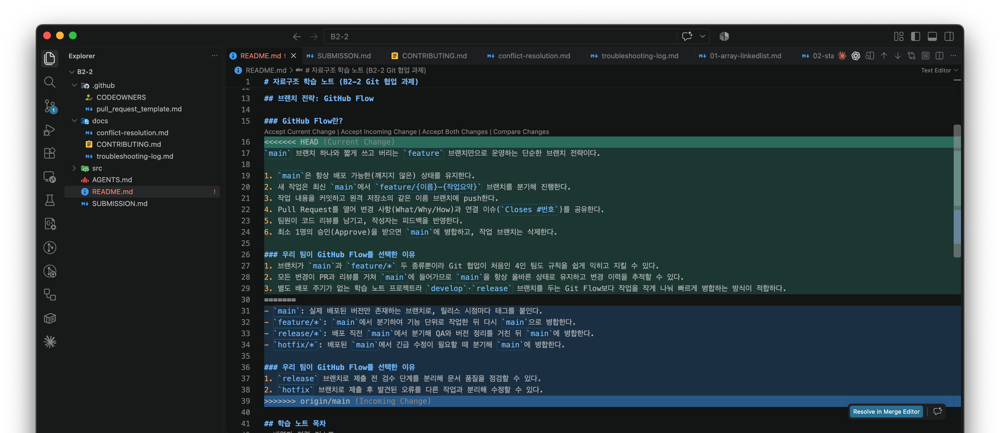
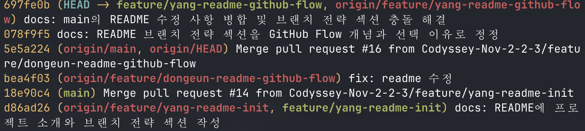

# Conflict Resolution Log

## 충돌 기록 #1
### 참여자
- 작성자: @ted1117 (B)
- 상대: @yoo040501 (C)

### 상황(What happened)
- 파일: `README.md`의 `## 브랜치 전략: GitHub Flow` 섹션 (15~25행)
- 배경: [#14](https://github.com/Codyssey-Nov-2-2-3/B2-2/pull/14)에서 README 브랜치 전략 섹션이 Git Flow(develop/release/hotfix) 개념으로 잘못 병합되어 [#15](https://github.com/Codyssey-Nov-2-2-3/B2-2/issues/15)로 이슈 등록
- 두 사람이 같은 커밋([`18e90c4`](https://github.com/Codyssey-Nov-2-2-3/B2-2/commit/18e90c48bc1fa6ca4b9603cedb15262fc48d67a8))에서 각자 브랜치를 분기해 같은 구간을 서로 다르게 수정
  - @yoo040501 `feature/dongeun-readme-github-flow` ([#16](https://github.com/Codyssey-Nov-2-2-3/B2-2/pull/16)): `develop` 설명 줄 삭제, `develop` → `main` 치환, 선택 이유를 2줄로 축소
  - @ted1117 `feature/yang-readme-github-flow` ([#17](https://github.com/Codyssey-Nov-2-2-3/B2-2/pull/17)): 개념 설명을 GitHub Flow 6단계로, 선택 이유를 3줄로 전면 재작성
- [#16](https://github.com/Codyssey-Nov-2-2-3/B2-2/pull/16)이 먼저 `main`에 병합된 뒤([`5e5a224`](https://github.com/Codyssey-Nov-2-2-3/B2-2/commit/5e5a2245cae970cbae55548dee7e4861e152bb60)), [#17](https://github.com/Codyssey-Nov-2-2-3/B2-2/pull/17) 브랜치에서 `origin/main`을 병합하자 충돌 발생
- 유형: 비자명 충돌 (같은 파일의 같은 hunk를 서로 다르게 수정)

### 충돌 내용(Conflict markers)
```txt
$ git merge origin/main
자동 병합: README.md
충돌 (내용): README.md에 병합 충돌
자동 병합이 실패했습니다. 충돌을 바로잡고 결과물을 커밋하십시오.
```

```txt
<<<<<<< HEAD
`main` 브랜치 하나와 짧게 쓰고 버리는 `feature` 브랜치만으로 운영하는 단순한 브랜치 전략이다.

1. `main`은 항상 배포 가능한(깨지지 않은) 상태를 유지한다.
2. 새 작업은 최신 `main`에서 `feature/{이름}-{작업요약}` 브랜치를 분기해 진행한다.
3. 작업 내용을 커밋하고 원격 저장소의 같은 이름 브랜치에 push한다.
4. Pull Request를 열어 변경 사항(What/Why/How)과 연결 이슈(`Closes #번호`)를 공유한다.
5. 팀원이 코드 리뷰를 남기고, 작성자는 피드백을 반영한다.
6. 최소 1명의 승인(Approve)을 받으면 `main`에 병합하고, 작업 브랜치는 삭제한다.

### 우리 팀이 GitHub Flow를 선택한 이유
1. 브랜치가 `main`과 `feature/*` 두 종류뿐이라 Git 협업이 처음인 4인 팀도 규칙을 쉽게 익히고 지킬 수 있다.
2. 모든 변경이 PR과 리뷰를 거쳐 `main`에 들어가므로 `main`을 항상 올바른 상태로 유지하고 변경 이력을 추적할 수 있다.
3. 별도 배포 주기가 없는 학습 노트 프로젝트라 `develop`·`release` 브랜치를 두는 Git Flow보다 작업을 작게 나눠 빠르게 병합하는 방식이 적합하다.
=======
- `main`: 실제 배포된 버전만 존재하는 브랜치로, 릴리스 시점마다 태그를 붙인다.
- `feature/*`: `main`에서 분기하여 기능 단위로 작업한 뒤 다시 `main`으로 병합한다.
- `release/*`: 배포 직전 `main`에서 분기해 QA와 버전 정리를 거친 뒤 `main`에 병합한다.
- `hotfix/*`: 배포된 `main`에서 긴급 수정이 필요할 때 분기해 `main`에 병합한다.

### 우리 팀이 GitHub Flow를 선택한 이유
1. `release` 브랜치로 제출 전 검수 단계를 분리해 문서 품질을 점검할 수 있다.
2. `hotfix` 브랜치로 제출 후 발견된 오류를 다른 작업과 분리해 수정할 수 있다.
>>>>>>> origin/main
```

- `<<<<<<< HEAD` ~ `=======`: 현재 브랜치(`feature/yang-readme-github-flow`, [#17](https://github.com/Codyssey-Nov-2-2-3/B2-2/pull/17))의 내용
- `=======` ~ `>>>>>>> origin/main`: 병합하려는 `origin/main`([#16](https://github.com/Codyssey-Nov-2-2-3/B2-2/pull/16) 반영본)의 내용



### 해결 과정(How)
- 전략: **choose one (구간별 선택)**
  - `GitHub Flow란?` 개념 설명 → `origin/main`([#16](https://github.com/Codyssey-Nov-2-2-3/B2-2/pull/16)) 쪽 채택
  - `우리 팀이 GitHub Flow를 선택한 이유` → `HEAD`([#17](https://github.com/Codyssey-Nov-2-2-3/B2-2/pull/17)) 쪽 3줄 채택
- 이유: 먼저 병합된 [#16](https://github.com/Codyssey-Nov-2-2-3/B2-2/pull/16)의 개념 설명과 [#17](https://github.com/Codyssey-Nov-2-2-3/B2-2/pull/17)의 선택 이유 3줄을 구간별로 채택해 두 사람의 작업을 모두 살렸다.
- 수행한 명령/절차

  ```bash
  git fetch origin
  git merge origin/main          # README.md 충돌 발생
  # VSCode에서 충돌 구간별로 채택할 쪽 선택, 충돌 마커 제거 확인
  git add README.md
  git commit -m "docs: main의 README 수정 사항 병합 및 브랜치 전략 섹션 충돌 해결"
  git push
  ```

### 결과(Outcome)
- 충돌 해결 커밋 [`697fe0b`](https://github.com/Codyssey-Nov-2-2-3/B2-2/commit/697fe0bcc7b5651efa9263c9be1cd4e6a7932551)를 push한 뒤 [#17](https://github.com/Codyssey-Nov-2-2-3/B2-2/pull/17)을 `main`에 병합([`999b36b`](https://github.com/Codyssey-Nov-2-2-3/B2-2/commit/999b36bf88af724259f2941e2eb01f92dd00ff47))
- 관련 PR: [#16](https://github.com/Codyssey-Nov-2-2-3/B2-2/pull/16)(먼저 병합), [#17](https://github.com/Codyssey-Nov-2-2-3/B2-2/pull/17)(충돌 해결 후 병합) / 관련 이슈: [#15](https://github.com/Codyssey-Nov-2-2-3/B2-2/issues/15) ([#17](https://github.com/Codyssey-Nov-2-2-3/B2-2/pull/17) 병합으로 자동 종료)
- 충돌은 해결했지만, 개념 설명에서 `origin/main` 쪽을 채택하면서 `release/*`·`hotfix/*` 설명이 README에 남았다. GitHub Flow 개념에 맞게 README를 추후 수정한다 → [#26](https://github.com/Codyssey-Nov-2-2-3/B2-2/issues/26)



### 배운 점(Learnings)
- 같은 이슈를 두 사람이 동시에 작업하면 같은 구간을 다르게 고치게 되어 충돌이 거의 확실하다. 이슈 담당자를 한 명으로 정하고, 같이 고칠 때는 수정 범위를 먼저 나눠야 한다.
- 문자열을 기계적으로 치환(`develop` → `main`)하는 수정은 문장은 고쳐도 개념(Git Flow 구조)은 고치지 못한다. 충돌을 해결할 때는 마커만 지우지 말고 결과 문서 전체의 일관성을 다시 읽어야 한다.

---

## 충돌 기록 #2: 트리·힙 노트 파일명 변경과 하단 내용 수정 (비자명 충돌)

### 참여자
- 작성자 (해결 담당): 조명환 (팀원 D, `@ChoMyeongHwan`)
- 상대 작성자: 김동은 (팀원 C, `@yoo040501`)

### 상황(What happened)
- Cycle 1 PR #12가 `main`에 병합된 직후(`037ecc0`), 팀원 C와 팀원 D가 같은 커밋에서 동시에 Cycle 2 브랜치를 분기했다.
  - `@yoo040501` (`feature/dongeun-nontrivial-conflict`, [PR #24](https://github.com/Codyssey-Nov-2-2-3/B2-2/pull/24), 커밋 `866b029`): `git mv src/03-tree-heap.md src/03-binary-tree-heap.md`로 파일명을 변경하고 `.github/CODEOWNERS`·`README.md` 링크를 갱신했으며, `## 6. 정리` 하단 문장을 보완한 뒤 `main`에 먼저 병합(`9d2073e`)했다.
  - `@ChoMyeongHwan` (`feature/cho-nontrivial-conflict`, 커밋 `4fc1a2b`): 이름 변경 전 경로인 `src/03-tree-heap.md` 하단에 `### 5-4. 힙 정렬(Heap Sort) 심화 예제`와 `## 6. 정리` 요약 항목을 추가했다.
- 이후 `feature/cho-nontrivial-conflict` 브랜치에서 `git merge origin/main`을 실행하자, Git이 파일명 변경(`src/03-tree-heap.md` → `src/03-binary-tree-heap.md`, 유사도 98%)을 감지하면서 새 경로의 인접 구간(394-400행)에서 **파일 이름 변경 + 내용 동시 수정 비자명 충돌**이 발생했다.

### 충돌 내용(Conflict markers)
> 아래 출력과 충돌 마커는 당시 발생한 충돌을 재현·기록하기 위해 원문 그대로 옮긴 것이며, 실제 파일의 충돌은 모두 해결되었다.

```text
$ git merge origin/main
Auto-merging src/03-binary-tree-heap.md
CONFLICT (content): Merge conflict in src/03-binary-tree-heap.md
Automatic merge failed; fix conflicts and then commit the result.
```

```text
$ git status
On branch feature/cho-nontrivial-conflict
Your branch is up to date with 'origin/feature/cho-nontrivial-conflict'.

You have unmerged paths.
  (fix conflicts and run "git commit")
  (use "git merge --abort" to abort the merge)

Changes to be committed:
	modified:   .github/CODEOWNERS
	modified:   README.md
	new file:   docs/images/revert-command-diff.png
	new file:   docs/images/revert-commit-log.png
	modified:   docs/troubleshooting-log.md
	deleted:    src/03-tree-heap.md

Unmerged paths:
  (use "git add <file>..." to mark resolution)
	both modified:   src/03-binary-tree-heap.md
```

```txt
<<<<<<< HEAD:src/03-tree-heap.md
- 특정 값을 찾는 작업과 우선순위가 가장 높은 값을 꺼내는 작업을 구분해서 자료구조를 선택한다.
- 힙 정렬은 최대 힙 구성을 활용해 최악에도 O(n log n) 시간과 제자리 기준 O(1) 추가 공간으로 정렬하지만, 불안정 정렬이다.
=======
- 특정 값의 탐색에는 BST를, 최솟값·최댓값을 반복해서 꺼내는 작업에는 힙을 활용한다.
- 최소 힙에서 값을 반복해서 꺼내면 오름차순 결과를 얻으며, 전체 추출 비용은 O(n log n)이다.
>>>>>>> origin/main:src/03-binary-tree-heap.md
```

- `<<<<<<< HEAD:src/03-tree-heap.md` 부터 `=======` 까지: 기존 파일명에서 작업한 현재 브랜치(`feature/cho-nontrivial-conflict`)의 수정 내용
- `=======` 부터 `>>>>>>> origin/main:src/03-binary-tree-heap.md` 까지: 파일명을 변경해 먼저 `main`에 병합된 `origin/main`([PR #24](https://github.com/Codyssey-Nov-2-2-3/B2-2/pull/24))의 수정 내용

### 해결 과정(How)
- **선택한 해결 전략**: **Refactor / Keep both**
- **의사결정 기준**:
  1. **파일 경로 결정**: 이미 `main`에 병합된 `.github/CODEOWNERS`와 `README.md` 목차 링크가 새 경로를 가리키고 있으므로 팀원 C가 변경한 `src/03-binary-tree-heap.md`를 유지하고 기존 `src/03-tree-heap.md`는 삭제 확정한다.
  2. **콘텐츠 통합**: 두 팀원의 작업이 모두 유실되지 않도록 팀원 C가 더 명확하게 다듬은 정리 문장 2줄과 팀원 D가 추가한 5-4절 힙 정렬 심화 예제 및 정리 문장 1줄을 모두 통합한다.
  3. **사후 검증**: `git diff --check`로 잔존 충돌 마커·공백 오류를 확인하고, 새 경로(`src/03-binary-tree-heap.md`)의 Python 예제 4종을 Python 3.12.13에서 모두 실행해 출력 일치를 검증한다.
- **실행한 명령 및 절차**:

```bash
git fetch origin
git merge origin/main          # src/03-binary-tree-heap.md 비자명 충돌 발생
git status                     # deleted: src/03-tree-heap.md, both modified: src/03-binary-tree-heap.md 확인
# src/03-binary-tree-heap.md에서 충돌 마커 제거 및 두 팀원 정리 내용 통합
git diff --check               # 남은 충돌 마커 및 공백 오류 없음 확인
# Python 3.12.13으로 src/03-binary-tree-heap.md 코드 블록 4종 실행 일치 검증
git add src/03-binary-tree-heap.md
git commit -m "docs: main의 트리·힙 파일명 변경 병합 및 비자명 충돌 해결"
```

### 결과(Outcome)
- **선행 PR**: [PR #24](https://github.com/Codyssey-Nov-2-2-3/B2-2/pull/24) (머지 커밋 `9d2073e`, 파일명 변경 `866b029`)
- **내용 추가 커밋**: `4fc1a2b` (`src/03-tree-heap.md`에 힙 정렬 심화 예제 및 정리 항목 추가)
- **충돌 해결 병합 커밋**: `51af3fe` (`docs: main의 트리·힙 파일명 변경 병합 및 비자명 충돌 해결`)
- **관련 PR**: [PR #28](https://github.com/Codyssey-Nov-2-2-3/B2-2/pull/28)
- 새 파일명 `src/03-binary-tree-heap.md`에 5-4절 힙 정렬 심화 예제와 두 팀원의 정리 문장이 모두 손실 없이 통합되었고, 기존 경로 `src/03-tree-heap.md`는 삭제되었으며 `README.md`·`.github/CODEOWNERS` 링크와 완전히 일치한다.

### 배운 점(Learnings)
- 파일명 변경(`git mv`)은 단일 파일만 바뀌는 것이 아니라 `README.md` 목차 링크와 `.github/CODEOWNERS`까지 연쇄적으로 영향을 주므로, 구조 변경 PR을 먼저 작게 병합한 뒤 후속 내용 수정 작업을 분기하는 것이 안전하다.
- Git의 이름 변경 추적 덕분에 충돌 마커에 `HEAD:이전경로`와 `origin/main:새경로`가 함께 표시되어 두 변경의 출처를 정확히 파악할 수 있었다.
- 충돌 해결 후에는 마커 제거에서 끝내지 않고 `git diff --check`, 문서 내 링크 정합성, 포함된 예제 코드의 재실행 검증까지 거쳐야 `main`의 무결성을 지킬 수 있다.
