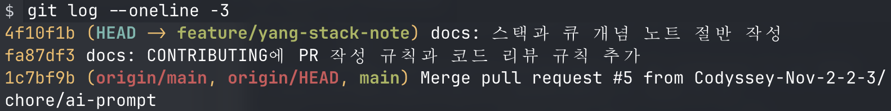
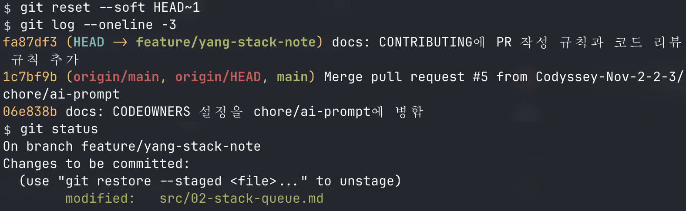
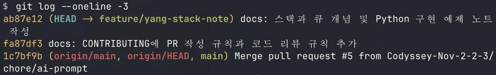

# Troubleshooting Log

## 시나리오: reset (`git reset --soft HEAD~1`)

### 참여자
- 양승조 (팀원 B, @ted1117): 실습 수행 및 기록 작성

### 상황
- `feature/yang-stack-note` 브랜치에서 `src/02-stack-queue.md` 노트를 절반(개념 설명)만 쓴 상태로 로컬 커밋했다. (`4f10f1b docs: 스택과 큐 개념 노트 절반 작성`)
- 아직 Python 구현 예제가 남아 있어, 이 미완성 커밋을 그대로 두지 않고 예제까지 완성한 하나의 커밋으로 다시 만들어야 했다.
- 이 커밋은 push하기 전이라 로컬에만 있었다. (`origin/main`은 [`1c7bf9b`](https://github.com/Codyssey-Nov-2-2-3/B2-2/commit/1c7bf9b9458cd409dc188136f08136612f473e23))



### 시도한 명령/절차
1. 최근 커밋 상태를 확인했다.

   ```bash
   git log --oneline -3
   # 4f10f1b (HEAD -> feature/yang-stack-note) docs: 스택과 큐 개념 노트 절반 작성
   # fa87df3 docs: CONTRIBUTING에 PR 작성 규칙과 코드 리뷰 규칙 추가
   ```

2. 커밋만 취소하고 변경 내용은 스테이징 상태로 남겼다.

   ```bash
   git reset --soft HEAD~1
   git log --oneline -3   # HEAD가 fa87df3으로 이동
   git status             # Changes to be committed: modified: src/02-stack-queue.md
   ```

3. 남은 Python 구현 예제를 노트에 추가한 뒤 하나의 커밋으로 다시 커밋했다.

   ```bash
   git add src/02-stack-queue.md
   git commit -m "docs: 스택과 큐 개념 및 Python 구현 예제 노트 작성"
   git log --oneline -3   # ab87e12 (HEAD -> feature/yang-stack-note) ...
   ```





### 결과
- 미완성 커밋 `4f10f1b`는 브랜치 히스토리에서 사라지고, 개념과 예제가 모두 담긴 커밋 [`ab87e12`](https://github.com/Codyssey-Nov-2-2-3/B2-2/commit/ab87e1209818e068c6693a93d377b0927655da1d) 하나로 정리되었다. 작성하던 노트 내용은 하나도 잃지 않았다.
- `4f10f1b`는 push된 적이 없어 원격 저장소에는 존재하지 않고, 로컬 `git reflog`에만 기록이 남아 있다. (실습 브랜치의 reflog 일부)

  ```txt
  ab87e12 feature/yang-stack-note@{1}: commit: docs: 스택과 큐 개념 및 Python 구현 예제 노트 작성
  fa87df3 feature/yang-stack-note@{2}: reset: moving to HEAD~1
  4f10f1b feature/yang-stack-note@{7}: commit: docs: 스택과 큐 개념 노트 절반 작성
  ```

- 주의할 점: `reset`은 커밋 히스토리를 다시 쓰므로 **push하기 전의 로컬 커밋에만** 사용한다. 이미 push한 커밋을 `reset`으로 지우고 다시 push하려면 강제 푸시가 필요하고, 그 커밋을 받은 팀원의 히스토리와 어긋난다. 공유된 커밋을 되돌릴 때는 `git revert`를 쓴다.

### 왜 이 방법을 선택했는가(Why)
- `--soft`는 커밋만 취소하고 변경 내용을 스테이징 상태로 유지하므로, 작성하던 노트를 그대로 둔 채 내용을 보완해 바로 다시 커밋할 수 있다.
- `--mixed`(기본값)는 변경을 unstaged로 돌려 `git add`를 다시 해야 하고, `--hard`는 작업 내용까지 지워 노트가 사라진다.
- `git revert`는 취소 커밋을 새로 추가해 "절반 작성 → 취소 → 다시 작성"이 히스토리에 모두 남는다. 아직 push하지 않은 로컬 커밋이라 다른 팀원에게 영향이 없으므로, 히스토리를 깔끔하게 정리하는 `reset --soft`가 적합했다.

## 시나리오: revert (`git revert`)

### 참여자

- 김동은 (팀원 C, @yoo040501): 실습 수행 및 기록 작성

### 상황

트리·힙 노트의 파일명 변경과 정리 문장 보완을 완료한 뒤,
`git revert` 실습을 위해 `heapify`의 시간복잡도를
올바른 `O(n)`에서 잘못된 `O(n log n)`으로 변경했다.

파일명 변경 작업은 유지하면서, 잘못된 설명을 넣은 커밋만
되돌리는 것이 목표였다.

### 실행한 명령과 절차

1. `src/03-binary-tree-heap.md`에서 `heapify`의 시간복잡도를
   실습용으로 잘못 변경했다.
2. 변경 사항을 별도 커밋으로 기록했다.

```bash
git add src/03-binary-tree-heap.md
git commit -m "docs: revert 실습용 heapify 복잡도 변경"
git log -1 --oneline
```

생성된 실습 커밋은 `583c189`이다.

3. 다른 커밋을 추가하지 않은 상태에서 마지막 커밋을 되돌렸다.

```bash
git revert --no-commit HEAD
git --no-pager diff --cached
git commit -m "fix: revert로 heapify 시간복잡도 복구"
```

생성된 복구 커밋은 `09ca0cb`이다.
`--no-commit`으로 되돌린 변경을 먼저 확인한 뒤,
팀의 커밋 메시지 규칙에 맞춰 별도로 커밋했다.

### 결과와 검증

| 커밋 | 내용 |
|---|---|
| `866b029` | 트리·힙 노트 파일명 변경 및 정리 보완 |
| `583c189` | 실습용으로 heapify 시간복잡도를 잘못 변경 |
| `09ca0cb` | revert로 올바른 시간복잡도 복구 |

다음 명령으로 실습 전과 복구 후 파일을 비교했다.

```bash
git diff 866b029 09ca0cb -- src/03-binary-tree-heap.md
```

출력이 없어 두 커밋의 파일 내용이 같음을 확인했다.
`heapify` 설명은 `O(n)`으로 복구됐으며,
파일명 변경과 정리 문장 보완은 유지됐다.

### 실행 증빙

`git revert --no-commit HEAD` 실행 후, 스테이징된 변경에서
heapify의 시간복잡도가 `O(n)`으로 복구되는 것을 확인했다.


실습 변경 커밋과 복구 커밋이 모두 이력에 남아 있다.


### revert를 선택한 이유와 주의 사항

- `revert`는 기존 커밋을 삭제하지 않고 반대 변경을 적용한다.
  이를 새 커밋으로 기록하면 변경과 복구 과정을 모두 추적할 수 있다.
- 공유된 커밋을 되돌릴 때도 기존 히스토리를 재작성하지 않는다.
- `HEAD`는 실행 시점의 마지막 커밋이다. 이 실습에서는
  `583c189`가 HEAD인 상태에서 실행했다.
- 특정 커밋을 되돌릴 때는 대상 해시를 먼저 확인해야 한다.
  파일명 변경 커밋까지 되돌리지 않도록 실습 변경을 별도 커밋으로 나눴다.
- `--no-commit` 옵션을 사용하면 자동으로 커밋되지 않으므로,
  결과 확인 후 직접 커밋해야 한다.