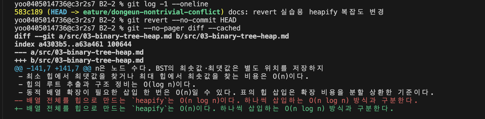

## 시나리오: revert (`git revert`)

### 참여자

- 김동은 (팀원 C, @yoo040501): 실습 수행 및 기록 작성

### 상황

트리·힙 노트의 파일명 변경과 정리 문장 보완을 완료한 뒤,
`git revert` 실습을 위해 `heapify`의 시간복잡도를
올바른 `O(n)`에서 잘못된 `O(n log n)`으로 변경했다.

파일명 변경 작업은 유지하면서, 잘못된 설명을 넣은 커밋만
되돌리는 것이 목표였다.

### 실행한 명령과 절차

1. `src/03-binary-tree-heap.md`에서 `heapify`의 시간복잡도를
   실습용으로 잘못 변경했다.
2. 변경 사항을 별도 커밋으로 기록했다.

```bash
git add src/03-binary-tree-heap.md
git commit -m "docs: revert 실습용 heapify 복잡도 변경"
git log -1 --oneline
```

생성된 실습 커밋은 `583c189`이다.

3. 다른 커밋을 추가하지 않은 상태에서 마지막 커밋을 되돌렸다.

```bash
git revert --no-commit HEAD
git --no-pager diff --cached
git commit -m "fix: revert로 heapify 시간복잡도 복구"
```

생성된 복구 커밋은 `09ca0cb`이다.
`--no-commit`으로 되돌린 변경을 먼저 확인한 뒤,
팀의 커밋 메시지 규칙에 맞춰 별도로 커밋했다.

### 결과와 검증

| 커밋 | 내용 |
|---|---|
| `866b029` | 트리·힙 노트 파일명 변경 및 정리 보완 |
| `583c189` | 실습용으로 heapify 시간복잡도를 잘못 변경 |
| `09ca0cb` | revert로 올바른 시간복잡도 복구 |

다음 명령으로 실습 전과 복구 후 파일을 비교했다.

```bash
git diff 866b029 09ca0cb -- src/03-binary-tree-heap.md
```

출력이 없어 두 커밋의 파일 내용이 같음을 확인했다.
`heapify` 설명은 `O(n)`으로 복구됐으며,
파일명 변경과 정리 문장 보완은 유지됐다.

### 실행 증빙

`git revert --no-commit HEAD` 실행 후, 스테이징된 변경에서
heapify의 시간복잡도가 `O(n)`으로 복구되는 것을 확인했다.



실습 변경 커밋과 복구 커밋이 모두 이력에 남아 있다.


### revert를 선택한 이유와 주의 사항

- `revert`는 기존 커밋을 삭제하지 않고 반대 변경을 적용한다.
  이를 새 커밋으로 기록하면 변경과 복구 과정을 모두 추적할 수 있다.
- 공유된 커밋을 되돌릴 때도 기존 히스토리를 재작성하지 않는다.
- `HEAD`는 실행 시점의 마지막 커밋이다. 이 실습에서는
  `583c189`가 HEAD인 상태에서 실행했다.
- 특정 커밋을 되돌릴 때는 대상 해시를 먼저 확인해야 한다.
  파일명 변경 커밋까지 되돌리지 않도록 실습 변경을 별도 커밋으로 나눴다.
- `--no-commit` 옵션을 사용하면 자동으로 커밋되지 않으므로,
  결과 확인 후 직접 커밋해야 한다.