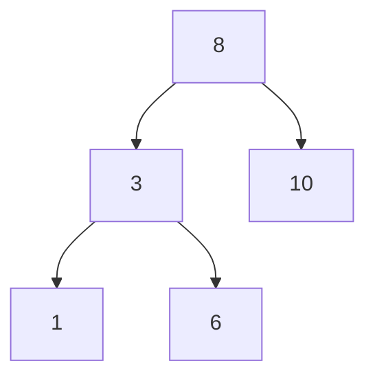
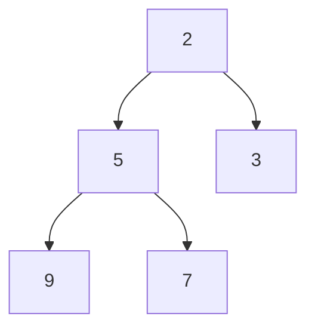

# 03. 트리와 힙

담당: 팀원 C (김동은) / 실행 환경: Python 3.10 이상

## 1. 트리의 개념과 용어

트리(Tree)는 노드와 간선으로 이루어진, 연결되어 있고 사이클이 없는 자료구조다.
하나의 노드를 루트로 정하면 부모와 자식의 계층 관계로 표현할 수 있다.
폴더 구조, 조직도처럼 상하 관계가 있는 데이터를 나타내는 데 사용한다.
이 노트에서는 루트가 있는 트리를 기준으로 설명한다.

| 용어 | 의미 |
|---|---|
| 노드(Node) | 데이터를 담는 구성 요소 |
| 간선(Edge) | 두 노드 사이의 연결 |
| 루트(Root) | 트리의 최상위 노드 |
| 부모·자식 | 간선으로 직접 연결된 위·아래 노드 |
| 형제(Sibling) | 같은 부모를 가진 노드들 |
| 리프(Leaf) | 자식이 없는 노드 |
| 깊이(Depth) | 루트에서 해당 노드까지의 간선 수 |
| 높이(Height) | 해당 노드에서 가장 먼 리프까지의 간선 수 |
| 서브트리(Subtree) | 특정 노드와 그 아래 모든 자손으로 이루어진 트리 |

예를 들어 A의 자식이 B와 C이고 B의 자식이 D라면, 루트는 A이고 리프는 C와 D다.
D의 깊이는 2이고 A의 높이도 2다. 간선 수 기준이므로 루트의 깊이와 리프의 높이는 0이다.
루트를 제외한 각 노드는 부모가 하나이며, 노드가 n개인 비어 있지 않은 트리에는 간선이 n - 1개 있다.

## 2. 이진 트리와 이진 탐색 트리

### 이진 트리(Binary Tree)

각 노드가 왼쪽과 오른쪽에 최대 하나씩, 총 최대 2개의 자식을 가지는 트리다.
자식이 하나이거나 없어도 된다. 이진 트리라는 조건만으로 값의 크기 순서는 정해지지 않는다.

### 이진 탐색 트리(Binary Search Tree, BST)

이진 트리에 다음과 같은 값 배치 규칙을 추가한 구조다. 여기서는 중복 값을 저장하지 않는다.

- 왼쪽 서브트리의 모든 값은 현재 노드의 값보다 작다.
- 오른쪽 서브트리의 모든 값은 현재 노드의 값보다 크다.
- 모든 노드에서 위 규칙을 만족해야 한다.

예를 들어 8, 3, 10, 1, 6을 차례로 삽입하면 다음 구조가 된다.



6을 탐색할 때는 8보다 작으므로 왼쪽으로, 3보다 크므로 오른쪽으로 이동한다.
이처럼 비교 결과에 따라 탐색 방향을 선택할 수 있다.
중복 값을 허용하는 구현에서는 별도 개수 저장 등 중복 처리 정책이 필요하다.

### 순회

순회는 트리의 모든 노드를 일정한 순서로 방문하는 것이다.

| 방식 | 방문 순서 | 위 트리의 방문 결과 |
|---|---|---|
| 전위 순회 | 현재 → 왼쪽 → 오른쪽 | 8, 3, 1, 6, 10 |
| 중위 순회 | 왼쪽 → 현재 → 오른쪽 | 1, 3, 6, 8, 10 |
| 후위 순회 | 왼쪽 → 오른쪽 → 현재 | 1, 6, 3, 10, 8 |

BST를 중위 순회하면 값을 오름차순으로 얻는다.
일반 이진 트리에서는 값 배치 규칙이 없으므로 중위 순회 결과가 정렬된다는 보장이 없다.

## 3. 힙의 개념과 특징

여기서 힙은 동적 메모리를 할당하는 영역이 아니라 **자료구조인 이진 힙(Binary Heap)**이다.
이진 힙은 완전 이진 트리 형태와 부모·자식 사이의 크기 규칙을 만족한다.

### 완전 이진 트리

마지막 레벨을 제외한 모든 레벨이 채워져 있고, 마지막 레벨도 왼쪽부터 빈자리 없이 채워진 트리다.
이 형태를 유지하므로 높이는 O(log n)이다.

| 종류 | 값 배치 규칙 | 루트 |
|---|---|---|
| 최소 힙 | 부모 값 ≤ 자식 값 | 전체 최솟값 |
| 최대 힙 | 부모 값 ≥ 자식 값 | 전체 최댓값 |

힙은 중복 값을 저장할 수 있다. 부모·자식의 관계만 보장하므로 형제끼리는 크기 순서가 정해져 있지 않다.
**힙의 내부 배열은 전체가 정렬된 배열이 아니다.**

### 배열 표현

노드를 위에서 아래로, 같은 레벨에서는 왼쪽부터 배열에 저장한다.
0부터 시작하는 인덱스에서 노드 위치가 i라면 다음 관계가 성립한다.

| 대상 | 인덱스 |
|---|---|
| 왼쪽 자식 | 2 * i + 1 |
| 오른쪽 자식 | 2 * i + 2 |
| 부모 | (i - 1) // 2 (i > 0) |

자식 인덱스가 배열 길이 이상이면 해당 자식은 없다.
예를 들어 `[2, 5, 3, 9, 7]`은 최소 힙이다. 2의 자식은 5와 3이고, 5의 자식은 9와 7이다.
5가 3보다 먼저 저장되어 있어도 부모·자식 규칙에는 문제가 없다.



### 삽입과 삭제 원리

- 삽입: 배열 끝에 새 값을 넣은 뒤, 부모와 비교하며 필요한 만큼 위로 올린다.
- 루트 삭제: 마지막 값을 루트로 옮기고 마지막 칸을 제거한 뒤, 자식과 비교하며 아래로 내린다.
- 최소 힙에서는 더 작은 자식과, 최대 힙에서는 더 큰 자식과 비교하여 내려간다.

힙은 우선순위 큐를 구현할 때 사용한다.
예를 들어 처리 순서가 가장 빠른 작업이나 비용이 가장 작은 후보를 반복해서 꺼낼 때 적합하다.

## 4. BST와 힙 비교 및 시간 복잡도

| 비교 항목 | BST | 이진 힙 |
|---|---|---|
| 형태 | 일반 BST는 한쪽으로 치우칠 수 있음 | 완전 이진 트리 |
| 값 배치 | 왼쪽 서브트리 < 현재 < 오른쪽 서브트리 | 부모·자식 사이의 크기 관계 |
| 특정 값 탐색 | 값 비교로 이동 방향 결정 | 일반적으로 전체 탐색 필요 |
| 정렬된 결과 | 중위 순회 | 루트를 반복해서 꺼내야 함 |
| 주요 활용 | 값 탐색, 범위 검색 | 우선순위 큐 |

n은 노드 수다. BST의 최솟값·최댓값은 별도 위치를 저장하지 않고 루트부터 찾는 기준이다.

| 연산 | 높이가 O(log n)인 BST | 한쪽으로 치우친 BST의 최악 | 이진 힙 |
|---|---|---|---|
| 특정 값 탐색 | O(log n) | O(n) | O(n) |
| 삽입 | O(log n) | O(n) | O(log n) |
| 특정 값 탐색 후 삭제 | O(log n) | O(n) | 위치 탐색 포함 O(n) |
| 최솟값·최댓값 조회 | O(log n) | O(n) | 힙 종류에 맞는 극값은 O(1) |
| 전체 값의 정렬된 출력 | 중위 순회 O(n) | 중위 순회 O(n) | 반복 추출 O(n log n) |

- 일반 BST가 자동으로 균형을 유지하는 것은 아니다. 아래 예제도 균형을 조정하지 않는다.
- 최소 힙에서 최댓값을 찾거나 최대 힙에서 최솟값을 찾는 비용은 O(n)이다.
- 힙의 루트 추출과 구조 정비는 O(log n)이다.
- 동적 배열 확장이 필요한 삽입 한 번은 O(n)일 수 있다. 표의 힙 삽입은 확장 비용을 분할 상환한 기준이다.
- 배열 전체를 힙으로 만드는 `heapify`는 O(n)이다. 하나씩 삽입하는 O(n log n) 방식과 구분한다.

## 5. Python 구현 예제와 실행 결과

각 Python 코드 블록은 독립적으로 실행할 수 있다.
원하는 블록을 파일로 저장하고 Python 3.10 이상에서 `python3 파일명.py`로 실행한다.

### 5-1. BST 삽입·탐색·중위 순회

`Node`는 값과 왼쪽·오른쪽 자식 노드의 참조를 저장한다.
`insert`는 중복이면 False, 새 값을 넣으면 True를 반환한다.
`contains`는 존재 여부를 반환하고, `inorder`는 오름차순 값 목록을 반환한다.

```python
class Node:
    def __init__(self, value):
        self.value = value
        self.left = None
        self.right = None


class BinarySearchTree:
    def __init__(self):
        self.root = None

    def insert(self, value):
        if self.root is None:
            self.root = Node(value)
            return True

        current = self.root
        while True:
            if value == current.value:
                return False  # 중복 값은 저장하지 않는다
            if value < current.value:
                if current.left is None:
                    current.left = Node(value)
                    return True
                current = current.left
            else:
                if current.right is None:
                    current.right = Node(value)
                    return True
                current = current.right

    def contains(self, value):
        current = self.root
        while current is not None:
            if value == current.value:
                return True
            if value < current.value:
                current = current.left
            else:
                current = current.right
        return False

    def inorder(self):
        result = []
        stack = []
        current = self.root
        while current is not None or stack:
            while current is not None:
                stack.append(current)
                current = current.left
            current = stack.pop()
            result.append(current.value)
            current = current.right
        return result


if __name__ == "__main__":
    tree = BinarySearchTree()
    print("빈 트리:", tree.inorder(), tree.contains(6))
    for value in [8, 3, 10, 1, 6]:
        tree.insert(value)
    print("중위 순회:", tree.inorder())
    print("6 탐색:", tree.contains(6))
    print("7 탐색:", tree.contains(7))
    print("6 중복 삽입:", tree.insert(6))
    print("삽입 후:", tree.inorder())
```

실행 결과:

```text
빈 트리: [] False
중위 순회: [1, 3, 6, 8, 10]
6 탐색: True
7 탐색: False
6 중복 삽입: False
삽입 후: [1, 3, 6, 8, 10]
```

`inorder`는 왼쪽으로 내려가는 경로를 스택에 보관한다.
더 내려갈 수 없으면 노드를 꺼내 방문하고 오른쪽 서브트리로 이동한다.
노드를 한 번씩 방문하므로 시간은 O(n), 스택 공간은 O(h), 반환 목록 공간은 O(n)이다.
h는 트리 높이이며, 이 구현은 재귀 호출 대신 반복문을 사용한다.

### 5-2. heapq로 최소 힙 사용하기

`heapq`는 리스트를 힙으로 다루는 표준 라이브러리다.
`heapify`는 원본 리스트를 직접 변경하고, `heappush`는 삽입, `heappop`은 최솟값 추출을 수행한다.
`heap[0]`은 최솟값을 조회하기만 하고 삭제하지 않는다.

```python
import heapq

heap = [7, 2, 9, 3, 5]
heapq.heapify(heap)
print("최솟값:", heap[0])

heapq.heappush(heap, 1)
heapq.heappush(heap, 3)  # 중복 값도 저장된다
print("삽입 후 최솟값:", heap[0])
print("추출:", heapq.heappop(heap))
print("추출 후 최솟값:", heap[0])

ordered = []
while heap:
    ordered.append(heapq.heappop(heap))
print("남은 값 추출:", ordered)
print("빈 힙:", heap)
```

실행 결과:

```text
최솟값: 2
삽입 후 최솟값: 1
추출: 1
추출 후 최솟값: 2
남은 값 추출: [2, 3, 3, 5, 7, 9]
빈 힙: []
```

빈 힙에서 `heap[0]`이나 `heappop`을 사용하면 IndexError가 발생한다.
위 예제는 `while heap`으로 비어 있지 않을 때만 값을 꺼낸다.
반복 추출은 힙을 비우므로 원본을 유지하려면 복사본으로 작업해야 한다.

### 5-3. 부호를 바꿔 최대 힙처럼 사용하기

Python 3.10에서도 사용할 수 있도록, 숫자의 부호를 바꿔 최소 힙에 저장한다.
부호를 바꾸면 큰 값일수록 작은 값이 되므로, 꺼낼 때 부호를 다시 바꾸면 원래 값이 큰 순서대로 나온다.

```python
import heapq

values = [7, 2, 9, 3, 5]
heap = [-value for value in values]
heapq.heapify(heap)
print("최댓값:", -heap[0])

heapq.heappush(heap, -10)
print("추출:", -heapq.heappop(heap))

ordered = []
while heap:
    ordered.append(-heapq.heappop(heap))
print("남은 값 추출:", ordered)
```

실행 결과:

```text
최댓값: 9
추출: 10
남은 값 추출: [9, 7, 5, 3, 2]
```

이 방법은 부호 반전이 가능한 숫자 데이터에 사용하는 방식이다.

## 6. 정리

- 이진 트리는 자식 수가 최대 2개이며, BST는 여기에 값 배치 규칙을 추가한다.
- BST의 탐색 성능은 높이에 따라 달라지고, 중위 순회하면 정렬된 결과를 얻는다.
- 이진 힙은 완전 이진 트리 형태와 부모·자식의 크기 관계를 유지한다.
- 힙의 루트는 최소 힙의 최솟값 또는 최대 힙의 최댓값이지만, 내부 배열 전체가 정렬되지는 않는다.
- 특정 값의 탐색에는 BST를, 최솟값·최댓값을 반복해서 꺼내는 작업에는 힙을 활용한다.
- 최소 힙에서 값을 반복해서 꺼내면 오름차순 결과를 얻으며, 전체 추출 비용은 O(n log n)이다.