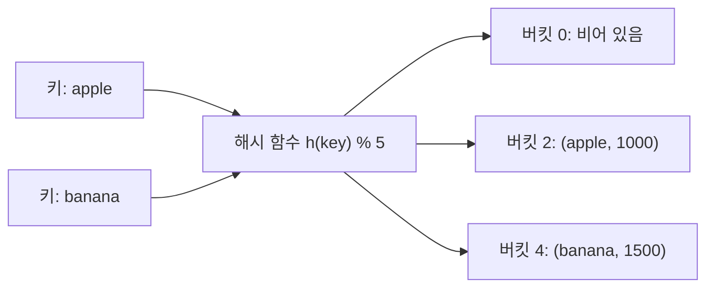
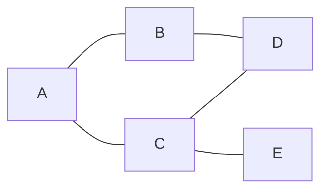

# 04. 해시 테이블과 그래프

담당: 팀원 D (조명환) / 실행 환경: Python 3.10 이상

## 1. 들어가며

배열, 연결 리스트, 스택, 큐가 데이터를 한 줄로 관리하는 선형 자료구조라면, **해시 테이블**(Hash Table)은 키를 이용해 데이터를 빠르게 조회하는 연관 배열 구조이고, **그래프**(Graph)는 개체 간의 복잡한 연결 관계를 표현하는 비선형 자료구조다. 두 구조는 실무에서 캐시·인덱싱(해시 테이블)과 네트워크·경로 탐색·의존성 분석(그래프)의 기반이 된다.

## 2. 해시 테이블 (Hash Table)

### 개념과 동작 원리

해시 테이블은 키(Key)와 값(Value)을 쌍으로 저장하며, **해시 함수**(Hash Function)를 이용해 키를 배열의 인덱스(버킷 위치)로 변환해 저장하고 조회하는 자료구조다.

- **해시 함수**: 임의의 키를 고정된 범위의 정수(배열 인덱스)로 변환한다. 좋은 해시 함수는 계산이 빠르고 키를 버킷 전체에 고르게 분산한다.
- **버킷**(Bucket): 해시 함수가 계산한 인덱스에 대응하는 저장 공간이다.

### 해시 충돌과 해결 방법

서로 다른 두 키가 같은 버킷 인덱스로 매핑되는 현상을 **해시 충돌**(Hash Collision)이라 한다. 버킷 수는 유한하고 가능한 키의 집합은 훨씬 크기 때문에(비둘기집 원리) 충돌은 피할 수 없으며, 대표적으로 다음 두 방식으로 해결한다.

| 해결 방식 | 동작 원리 | 장점 | 단점 |
|---|---|---|---|
| **체이닝**(Separate Chaining) | 같은 버킷에 연결 리스트(또는 리스트)로 여러 항목을 매달아 저장 | 구현이 단순하고 테이블이 차도 확장이 유연함 | 포인터·리스트 추가 메모리 필요, 한 버킷에 몰리면 탐색 저하 |
| **개방 주소법**(Open Addressing) | 충돌 시 선형 탐사·이차 탐사·이중 해싱 등으로 다른 빈 버킷을 찾아 저장 | 추가 자료구조 없이 배열 내부에 저장해 캐시 지역성이 좋음 | 부하율이 높아지면 군집화(Clustering)로 성능 급락, 삭제 처리가 까다로움 |

체이닝 방식에서 `apple`과 `grape`가 모두 버킷 2로 매핑된 경우의 구조는 다음과 같다.

### 시간복잡도와 부하율

| 연산 | 평균 시간복잡도 | 최악 시간복잡도 | 비고 |
|---|---|---|---|
| 탐색 (`get`) | O(1) | O(n) | 모든 키가 한 버킷에 충돌할 때 최악 O(n) |
| 삽입 (`put`) | O(1) | O(n) | 리해싱 발생 시 일시적 O(n), 분할 상환 O(1) |
| 삭제 (`delete`) | O(1) | O(n) | 탐색 비용에 비례 |

- **부하율**(Load Factor, α = 저장된 원소 수 / 전체 버킷 수): 부하율이 커질수록 충돌 확률이 높아져 평균 O(1) 성능이 무너진다.
- 이를 막기 위해 부하율이 임계치(예: 0.7 이상)를 넘으면 버킷 배열 크기를 늘리고 기존 키를 새 크기에 맞춰 다시 배치하는 **리해싱**(Rehashing)을 수행한다.

### 파이썬의 `dict`와 `set`

파이썬의 `dict`와 `set`은 CPython 내부에서 개방 주소법 기반 해시 테이블로 구현되어 있다.

- 키(또는 `set` 원소)는 반드시 **해시 가능**(Hashable)해야 한다. `int`, `str`, 원소가 모두 불변인 `tuple`은 키로 쓸 수 있지만, 값이 바뀔 수 있는 `list`, `dict`, `set`은 `TypeError: unhashable type`이 발생한다.
- 평균 조회·삽입·삭제가 O(1)이므로 리스트에서 `x in items`(O(n))를 반복하는 대신 `set`이나 `dict`를 쓰면 탐색 성능을 크게 개선할 수 있다.
- Python 3.7부터 `dict`는 키의 삽입 순서를 공식적으로 보장한다.

## 3. 그래프 (Graph)

### 개념과 기본 용어

**그래프**(Graph)는 개체를 나타내는 **정점**(Vertex 또는 Node)과 정점 사이의 연결을 나타내는 **간선**(Edge)의 집합 `G = (V, E)`로 이루어진 비선형 자료구조다. 계층 구조와 비순환 조건을 강제하는 트리와 달리, 그래프는 사이클이나 다대다 연결을 자유롭게 표현할 수 있다.

| 용어 | 의미 |
|---|---|
| 정점(Vertex) | 데이터를 나타내는 개체 (예: 도시, 사용자, 모듈) |
| 간선(Edge) | 두 정점을 잇는 연결 관계 (예: 도로, 팔로우, 의존성) |
| 방향 / 무방향 그래프 | 간선에 방향이 있으면 방향 그래프, 양방향 대칭이면 무방향 그래프 |
| 가중치 그래프 | 간선에 거리·비용 같은 수치(Weight)가 부여된 그래프 |
| 차수(Degree) | 한 정점에 연결된 간선의 수 (방향 그래프는 진입/진출 차수로 구분) |
| 경로(Path)와 사이클(Cycle) | 간선을 따라 이동하는 정점의 나열이 경로이며, 출발 정점으로 다시 돌아오면 사이클 |

예를 들어 정점 A-E로 이루어진 무방향 그래프는 다음과 같이 표현할 수 있다.

### 그래프 표현 방식: 인접 리스트 vs 인접 행렬

정점 수를 V, 간선 수를 E라 할 때 그래프를 메모리에 저장하는 대표 방식 두 가지는 다음과 같다.

| 비교 항목 | 인접 리스트 (Adjacency List) | 인접 행렬 (Adjacency Matrix) |
|---|---|---|
| 저장 방식 | 각 정점마다 연결된 이웃 목록을 `dict[str, list[str]]` 등으로 보관 | V × V 크기 2차원 배열에 간선 유무(또는 가중치) 기록 |
| 공간복잡도 | O(V + E) | O(V²) |
| 두 정점 간 간선 확인 | O(deg(v)) | O(1) |
| 한 정점의 모든 이웃 순회 | O(deg(v)) | O(V) |
| 적합한 경우 | 간선이 적은 희소 그래프(실무 대부분) | 정점 수가 작고 간선이 많은 밀집 그래프 |

### 그래프 탐색: BFS와 DFS

그래프의 모든 정점을 체계적으로 방문하는 대표 탐색 알고리즘은 **너비 우선 탐색**(BFS)과 **깊이 우선 탐색**(DFS)이다. 사이클이 있는 그래프에서 무한 루프를 막으려면 이미 방문한 정점을 `set`으로 기록해야 한다.

| 구분 | BFS (너비 우선 탐색) | DFS (깊이 우선 탐색) |
|---|---|---|
| 탐색 순서 | 시작점에서 가까운(간선 수가 적은) 정점부터 레벨 순 방문 | 한 분기를 끝까지 파고든 뒤 되돌아와 다음 분기 탐색 |
| 핵심 자료구조 | 큐 (`collections.deque`) | 스택 (`list`) 또는 재귀 호출 스택 |
| 시간복잡도 (인접 리스트) | O(V + E) | O(V + E) |
| 공간복잡도 | O(V) | O(V) |
| 대표 활용 | 무가중치 최단 경로, 최단 이동 횟수 | 연결 요소 탐색, 사이클 탐지, 위상 정렬 |
